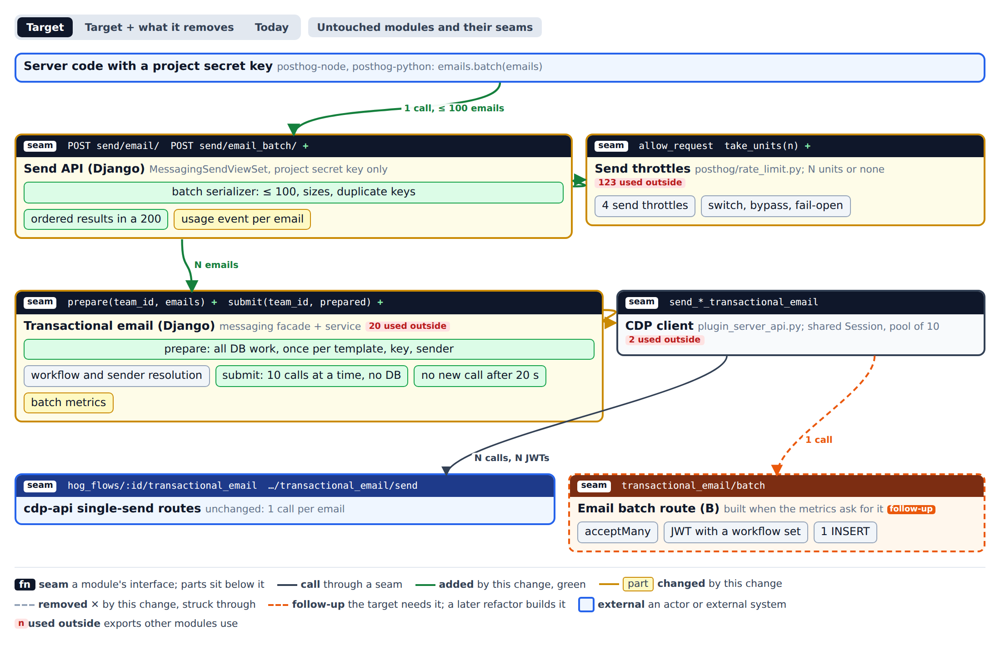
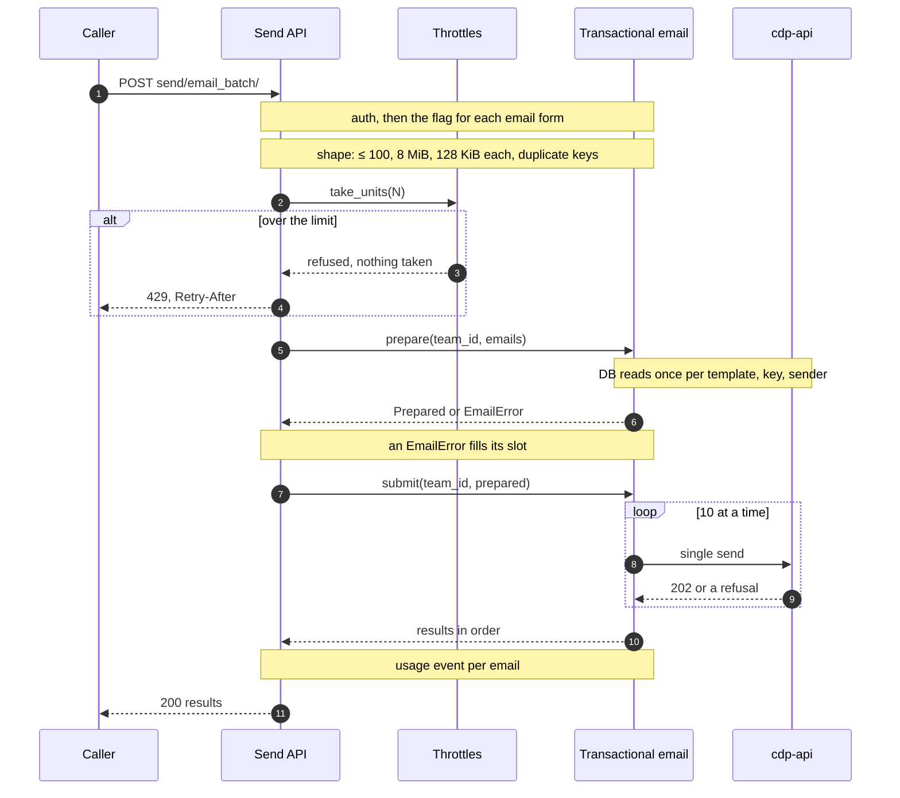
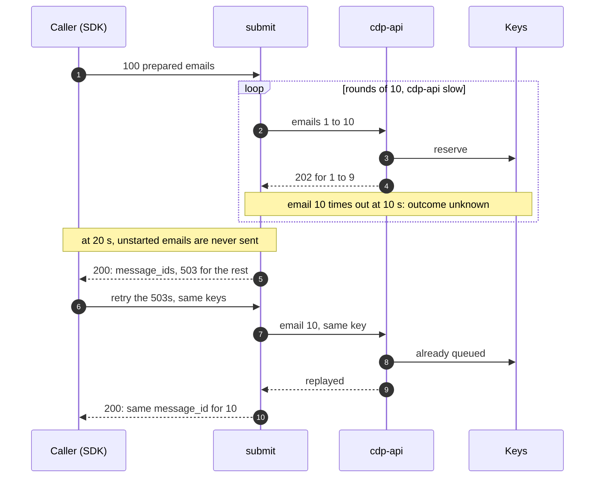

# Email batch

How the email batch fits into the single transactional email send.
An email batch is one API call that sends up to 100 separate transactional emails.
Each email in it is a full single send, in either of its two forms.

This doc is a prototype artifact.
Its branch is never merged.
It becomes the interface section of the implementation spec.

## The question

The single send already runs in two products.
Django validates the request, resolves the workflow and the sender, and makes one internal call to cdp-api.
cdp-api reserves the idempotency key, runs the refusal checks and queues one job.

A batch could reuse that path in two ways:

- **A.** Django loops over the emails and calls the existing single-send route once per email.
- **B.** Django makes one internal call per batch to a new cdp-api route, which checks every email and queues them in one insert.

**Decision: A now, B when the metrics ask for it.**
A changes no cdp-api code, no internal auth and no queue code.
Its cost is one HTTP call per email, so a batch takes longer than B would.
The batch metrics below measure that cost.
B is a follow-up, and the thresholds that trigger it are kept outside this public repository.
See [ADR 0001](email-batch/adr/0001-loop-over-the-single-send.md).

## Modules and seams



[Open the module page](email-batch/modules.html) to switch views.
[Target + what it removes](email-batch/modules-removed.png) strikes through the facade calls the single send stops using.
[Today](email-batch/modules-today.png) shows the single send as it is.
[The untouched modules](email-batch/modules-untouched.png) include cdp-api's internal auth, the idempotency store and the queue.
The spec is [`modules.json`](email-batch/modules.json).

- **Send API (Django).** `MessagingSendViewSet` gets one more action, `send/email_batch/` (the path is a placeholder).
  It accepts only project secret keys, as the single send does.
  The view keeps the serializer, the whole-call checks and the mapping to HTTP answers.
- **Send throttles.** `posthog/rate_limit.py` gets `take_units(n)`, which takes N units from every send throttle or none from any.
- **Transactional email (Django).** The messaging facade exposes `prepare` and `submit`.
  `prepare` does all the database work.
  `submit` makes the CDP calls and does no database work.
  The single send becomes a batch of one through the same two calls.
- **CDP client.** Unchanged.
  The batch calls it once per email.
- **cdp-api.** Unchanged.

## Call paths

### Main write



- The whole-call checks run in this order: auth, then the flag for each email form in the batch, then shape, then the throttle units.
  A failure in any of them answers the whole call and queues nothing.
- The shape check runs before the throttle, so a malformed batch takes no units.
  The batch action declares no DRF throttles, so DRF takes no extra unit for the request.
- After the throttle, every failure belongs to one email and fills that email's slot in the `200`.
  An email that `prepare` refuses gets no CDP call, and the other emails still go out.
  Its units stay taken, as on the single send.

### Failure: cdp-api is slow, then a retry



- Each CDP call keeps the single send's 10-second timeout.
  `submit` starts no new call 20 seconds into the batch.
- An email whose call timed out may already be queued.
  An email that never started was never sent.
  Both get the single send's `503 delivery_unavailable` in their slot, with a message that says which case applies.
- A retry with the same `idempotency_key` is safe in both cases.
  The idempotency store answers a replay with the first `message_id`.

The status read, `GET messaging/emails/{id}/`, is unchanged.
It takes one `message_id` per read.

## Contracts

### `POST /api/projects/{id}/messaging/send/email_batch/`

```python
# Request: 1 to 100 single-send bodies, with the key in the body instead of a header.
class SendEmailBatchSerializer(serializers.Serializer):
    emails = SendEmailBatchItemSerializer(many=True, min_length=1, max_length=100)

class SendEmailBatchItemSerializer(SendEmailSerializer):  # template_id + message_data, or template_key + content
    idempotency_key = serializers.RegexField(IDEMPOTENCY_KEY_PATTERN, required=False)

# 200: one result per email, in request order.
# {"results": [{"message_id": "…", "replayed": false},
#              {"error": {"status": 422, "type": "…", "code": "recipient_suppressed", "detail": "…"}}]}
```

- **Invariants.**
  - `len(results) == len(emails)`, in request order.
  - A `200` means every email has its own answer, even when every email was refused.
  - `replayed` means what it means on the single send.
  - Each `error` slot is the single send's error response body, built by the same code, plus its `status`.
    A field the single send's error gains, the batch slot gains too.
- **Whole-call errors.** These queue nothing:
  - `401` for auth.
  - `403` when a flag is off for an email form the batch uses.
  - `400` for shape: the email count, a duplicate `idempotency_key`, or `content_too_large` for an email over 128 KiB.
  - `413` for a body over 8 MiB.
    Django's own body limit is higher, so the view measures this itself, before it parses the emails.
  - `429 throttled`, with `Retry-After`.
- **Performance.** A batch of N takes about ⌈N/10⌉ CDP calls in a row.
  No call starts after 20 seconds, and a call already running keeps its 10-second timeout, so the worst case is about 30 seconds.

### The messaging facade

```python
# products/messaging/backend/facade/contracts.py
@frozen
class TemplateEmail:
    template_id: UUID
    message_data: dict[str, Any]

@frozen
class EmailRequest:
    content: TemplateEmail | CodeEmail
    to: str
    distinct_id: str | None
    idempotency_key: str | None

@frozen
class PreparedEmail:  # opaque: the workflow, the CDP route and the payload
    ...

@frozen
class EmailRefused:
    error: TransactionalEmailError

@frozen
class EmailUnavailable:
    started: bool  # True: the call timed out, so the email may still go out

EmailResult = QueuedEmail | EmailRefused | EmailUnavailable  # the spec names this type

# products/messaging/backend/facade/transactional_email.py
def prepare(team_id: int, emails: Sequence[EmailRequest]) -> list[PreparedEmail | EmailRefused]: ...
def submit(team_id: int, prepared: Sequence[PreparedEmail | EmailRefused]) -> list[EmailResult]: ...
```

- **Invariants.**
  - Both calls return one item per input, in the same order.
  - `prepare` does all the database work.
    It reads each unique template, key and sender once per request, and it creates a new key's workflow once.
    It takes no request context, because the flags stay in the view.
  - `submit` touches no database.
    It makes one CDP call per `PreparedEmail`, at most 10 at a time, which matches the shared HTTP session's connection pool.
    It starts no call after 20 seconds.
  - An `EmailRefused` passes through `submit` unchanged.
- **Error modes.**
  - A failure that belongs to one email never raises.
    It becomes `EmailRefused` or `EmailUnavailable`.
  - `EmailUnavailable` keeps the single send's code, `delivery_unavailable`, and its status, `503`.
    With `started=True` it carries the existing "the email may still go out, retry with the same key" message.
    Otherwise it carries the plain "pipeline unavailable" message.
  - Only a programming error raises.
- **The single send** is `submit(team_id, prepare(team_id, [email]))[0]`, run inline.
  The view turns the result into a `202`, or into the error's status.
- **What the facade loses.** `send_code_email`, `send_transactional_email` and `require_code_email_access` go.
  So do the stage-timer internals and sender patterns that the view imports today.
  `require_code_email_access` had one caller, which accepts only project secret keys, and both of its access callbacks return at once for those keys.

### `take_units` in `posthog/rate_limit.py`

```python
def take_units(
    throttles: Sequence[SimpleRateThrottle], request: Request, view: APIView, units: int
) -> float | None:
    """Take `units` from every throttle, or from none. None when taken; otherwise the seconds until all could."""
```

- **Invariants.**
  - It takes the units from every throttle, or from none of them.
  - `units=1` behaves like `allow_request`.
  - It keeps the existing rules in `_allow_request_internal`: the on/off switch, the team bypass, and letting the request through when the throttle itself fails.
- **Error modes.** It never raises.
  When it returns a number of seconds, the view answers `429` with `Retry-After` rounded up.
- **Performance.** Each throttle costs one cache read and one cache write, as DRF does today.
  Two processes can race between the read and the write, as they can with `allow_request`.

### Metrics

- `messaging_email_batch_duration_seconds`: a histogram of the whole batch, labeled by size (1, 2–10, 11–50, 51–100), with buckets up to 60 seconds.
  The stage histogram can't hold a batch, because its `total` stage times one request and its top bucket is 15 seconds.
- A `route` label (`send_email`, `send_email_batch`) on the two CDP request metrics.
  It shows whether batch traffic slows each CDP call, which is the cost B would remove.
- The usage event `transactional email api send`, once per email, with `route: "send_email_batch"` and `batch_size`.
  Send counts stay correct, and the `route` breakdown shows the batch's share of sends.

## Follow-ups

- **B: the email batch route in cdp-api.** Built when the batch metrics cross the thresholds kept outside this repository.
  - `acceptMany(team, emails) -> ordered outcomes`: one admission module for the single send and the batch, out of the route closure in `cdp-api.ts` (Strong).
  - A batch JWT purpose whose token pins the team and the set of workflow IDs, with every email checked against the set.
    A route without `:id` accepts any workflow claim today, so the set check is required (Worth exploring).
  - One `bulkCreateJobs` insert per batch, so the queue answer is all or none (Worth exploring).
    `queueInvocations` splits a batch into chunks it inserts in parallel, so a smaller chunk size could commit part of a batch.
  - Django's single send through the batch route, which retires the per-workflow routes and their token purpose (Worth exploring).
  - An `enqueueMany -> {confirmed, rejected, unknown}` result on the job queue, in place of the one-insert option (Worth exploring; not asked in the rounds).
- **Random SDK keys.** The SDKs give each email without an `idempotency_key` a random one, made once and kept across retries.
  A whole-call retry, or a retry of a timed-out email, then can't send an email twice.
  This covers the single send too.
- **Bold: transactional email owns its identity** (Speculative).
  Messaging would own email identity, content, sender and preparation, with workflows as an execution layer behind an internal seam.
  Today a new `template_key` creates a synthetic workflow.
  This reopens the workflow-backed metrics, run history and versions, so it is out of scope for the batch.
- **Split `cdp-api.ts`** (Worth exploring; not asked in the rounds).
  The file holds every CDP route, and its handlers reach through `invocationResultsService` to its rows service.

## Decisions and ADRs

| Seam                                   | Decision                                                               | Record                                                        |
| -------------------------------------- | ---------------------------------------------------------------------- | ------------------------------------------------------------- |
| Where the loop runs                    | Django loops over the existing single-send route                       | [ADR 0001](email-batch/adr/0001-loop-over-the-single-send.md) |
| The batch's answer                     | `200` with one result per email; unknown outcomes are per-email `503`s | [ADR 0002](email-batch/adr/0002-answer-per-email-in-a-200.md) |
| Throttle units                         | A batch of N takes N units from every send throttle, or none           | [ADR 0003](email-batch/adr/0003-n-units-or-none.md)           |
| `prepare` and `submit`                 | All database work in `prepare`, all CDP calls in `submit`              | Misses the bar: an internal seam, easy to reverse.            |
| 10 calls at a time, 20-second deadline | Tuning values                                                          | Misses the bar: a constant changes them.                      |
| Batch metrics                          | Histogram, `route` label, usage event                                  | Misses the bar: easy to reverse.                              |
| Drop `require_code_email_access`       | Its only caller can't reach its checks                                 | Misses the bar: no real alternative.                          |
| `413` for 8 MiB                        | The request as a whole is too large                                    | Misses the bar: no real alternative.                          |
