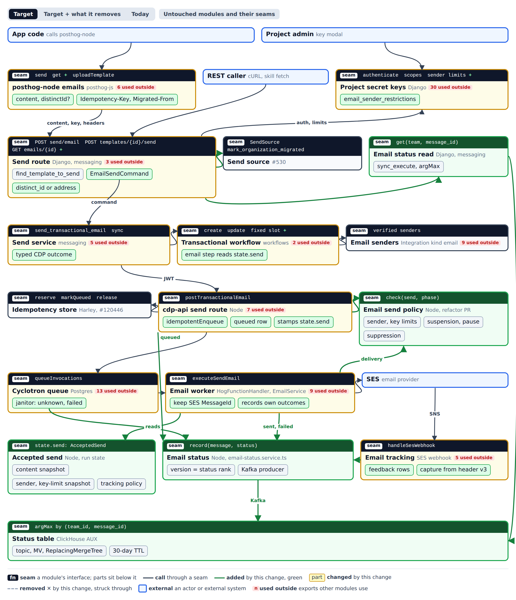
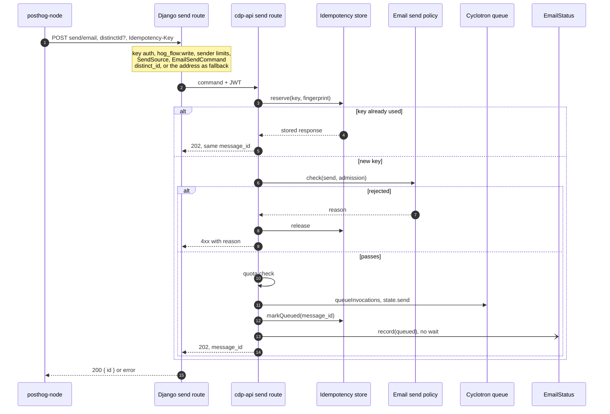
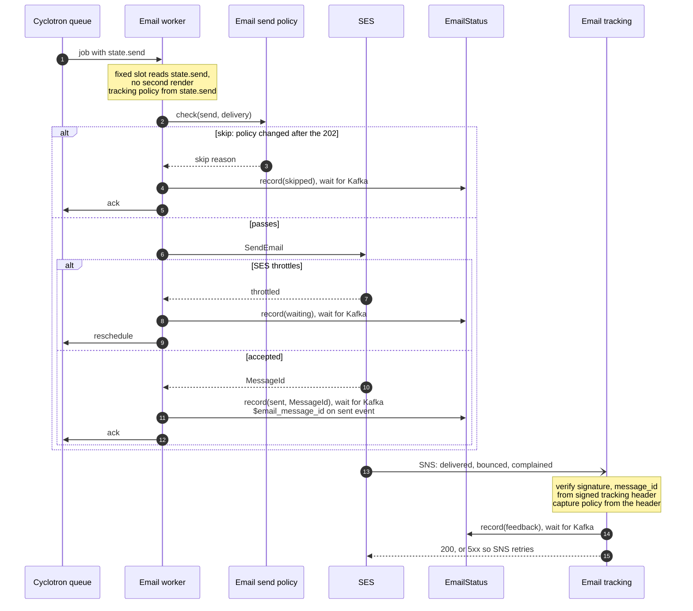
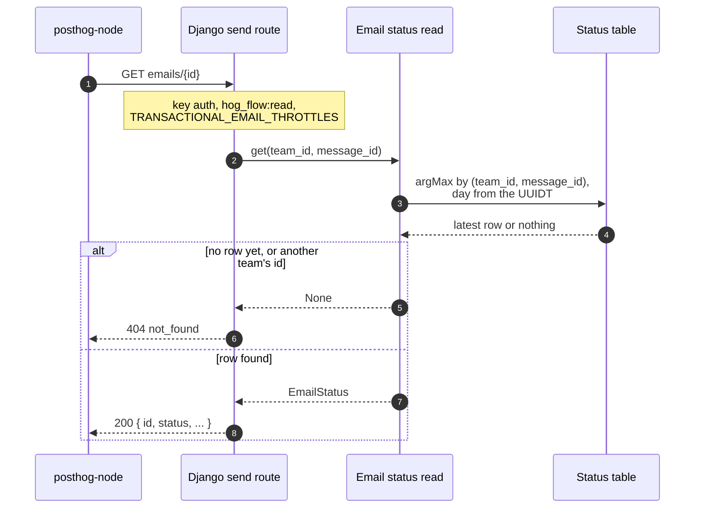
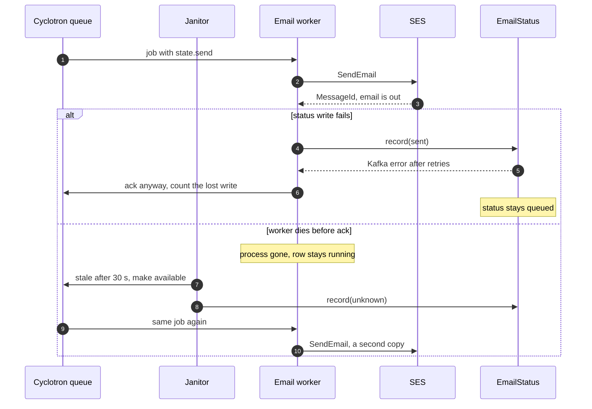

# Resend parity: architecture

The question: how should PostHog be shaped so that an app can send a transactional email from code, the way it does with Resend, and read the email's status back?
Prototype ticket [Silthus/posthog#526](https://github.com/Silthus/posthog/issues/526), on map [#461](https://github.com/Silthus/posthog/issues/461).
The product decisions are #525's. This page holds the structure only.

## Context and modules

Three actors drive the change:

- **App code** sends through posthog-node.
- **REST callers** send with cURL or the skill's `fetch`.
- **A project admin** restricts a key's senders in the key modal.

The migration skill and the Wizard are not runtime actors. They write code that becomes one of the first two.

The module page below covers rungs 1 and 2. Green is new, yellow is changed. [The interactive page](resend-parity/modules.html) also shows Target + what it removes, Today, and the untouched modules beside the change.



**Premise.** Sends stay on HogFlow, one workflow per template (#525).

- Django builds one `EmailSendCommand` and gets back a typed outcome.
- cdp-api checks the send, queues it once per idempotency key, and stamps the accepted content on the run as `state.send`.
- The email worker delivers from `state.send` without rendering it again.
- Every module that changes an email's status writes it through `EmailStatus`.
  The status lands in a ClickHouse table that Django reads for `GET emails/{id}`.

The refactors land first, as mechanical PRs, and the feature PRs stack on them:

- **R1** moves the two copies of the send checks into `EmailSendPolicy`.
- **R2** introduces `EmailSendCommand` and the typed CDP outcome.
- **R3** wraps Harley's idempotency store in `idempotentEnqueue`.

## Call paths

### Write, request half

The request half ends when cdp-api has queued the job and answered with its message id.



### Write, delivery half

After SES accepts an email, no status failure may cause a second send.



### Read



### Failure: SES accepted, the worker cannot finish



## Contracts

Every seam takes a typed value and returns a typed outcome. No caller needs to know Valkey, Kafka or ClickHouse.

### Node and posthog-node

```typescript
// ─── posthog-node: packages/node/src/emails.ts ──────────────────────────────

/** html() and text() now, react() as a follow-up. Code content has no name of its own, so the send carries `key`. */
export type CodeContent = Readonly<{ kind: 'code'; subject: string; html?: string; text: string }>
/** libraryTemplate('welcome', data). The library template's key is the mail key. */
export type LibraryTemplate = Readonly<{ kind: 'library'; key: string; data: Record<string, unknown> }>

export type SendEmailOptions = {
  to: string // one recipient
  distinctId?: string // the recipient, never the requester from withContext; absent falls back to the address
  from?: string
  replyTo?: string | string[]
  idempotencyKey?: string // the SDK makes one when absent
  captureEngagement?: boolean // on by default for code sends; these events count as analytics events
} & ({ key: string; content: CodeContent } | { key?: never; content: LibraryTemplate })

export type EmailStatus =
  | 'queued'
  | 'waiting'
  | 'unknown'
  | 'skipped'
  | 'failed'
  | 'sent'
  | 'delivered'
  | 'bounced'
  | 'complained'

export type GetEmailResult =
  | { data: { id: string; status: EmailStatus; createdAt: string; statusAt: string; reason?: string }; error: null }
  | { data: null; error: EmailError } // EmailError: { name, code, message, why, fix, statusCode, docsUrl }

export interface Emails {
  /** Never throws. Retries network errors, 409 in flight, 429 and 503 with the same key, honoring Retry-After. */
  send(options: SendEmailOptions): Promise<SendEmailResult>
  /** `status`, not Resend's `last_event`. 404 for an unknown id and for the first seconds after a send. No retries. */
  get(id: string): Promise<GetEmailResult>
}

// ─── cdp-api request: nodejs/src/cdp/services/hogflows/transactional-email.ts ─

export const TransactionalEmailRequestSchema = z.object({
  to: z.string().email(),
  distinct_id: z.string().min(1), // Django sets `to` here when the caller sent no distinctId
  identity: z.enum(['distinct_id', 'email_only']), // the email lookup follow-up adds 'email_lookup'
  variables: z.record(z.string(), z.any()).default({}),
  idempotency_key: z.string().min(1).max(255).optional(),
  send: AcceptedSendSchema.optional(), // code sends; library sends pin in PR 8
})

// ─── Run state: nodejs/src/cdp/types.ts, HogFlowInvocationContext.send ───────

export type AcceptedSend = Readonly<{
  content?: Readonly<{ subject: string; html?: string; text: string }>
  from?: string
  replyTo?: readonly string[]
  tracking: SendTrackingPolicy
  keyLimits?: SenderLimits // PR 9
  attachments?: readonly StoredAttachmentRef[] // PR 7, bytes never in the run state
}>

/** Scoped to this send. Never read from or written to the project-wide switch. */
export type SendTrackingPolicy = Readonly<{ captureEngagement: boolean; trackOpensAndClicks: boolean }>

// ─── Send policy: nodejs/src/cdp/services/messaging/email-send-policy.ts ─────

export interface EmailSendPolicy {
  /**
   * Admission rejects every PolicyCode with why and fix (#525: no silent skips).
   * Delivery checks again and records `skipped` only for what changed after the 202. Never uses pacing slots.
   */
  check(send: SendCandidate, phase: 'admission' | 'delivery'): Promise<PolicyDecision>
}
export type PolicyDecision = { ok: true } | { ok: false; code: PolicyCode; why: string; fix: string }
export type PolicyCode =
  | 'sender_not_verified'
  | 'sender_not_allowed'
  | 'sending_suspended'
  | 'template_paused'
  | 'recipient_suppressed'

// ─── Idempotent enqueue: cdp-api, over Harley's IdempotencyKeys ──────────────

export function idempotentEnqueue(
  request: { teamId: number; key?: string; fingerprint: unknown; invocation: CyclotronJobInvocationHogFlow },
  admit: () => Promise<PolicyDecision | QuotaLimited>
): Promise<EnqueueResult>
// Scope 'transactional-email', shared by both routes: a key reused across them is 422 invalid_idempotent_request.
// Fingerprint: template key, to, distinct_id, identity, variables, send. Replay runs before admit.
export type EnqueueResult =
  | { kind: 'queued'; messageId: string; replayed: boolean }
  | { kind: 'rejected'; decision: PolicyDecision | QuotaLimited } // key released
  | { kind: 'in_flight' }
  | { kind: 'conflict' }
  | { kind: 'unavailable' }

// ─── Status writer: nodejs/src/cdp/services/messaging/email-status.service.ts ─

export interface EmailStatusWriter {
  /** Resolves when Kafka confirms. The worker, tracking and the janitor use this. */
  record(change: StatusChange): Promise<void>
  /** Does not wait. Only cdp-api uses this, for `queued`. */
  recordInBackground(change: StatusChange): void
}
export type StatusChange = Readonly<{
  teamId: number
  messageId: string // the invocation UUIDT
  status: EmailStatus
  at: Date
  reason?: PolicyCode | 'provider_error' | 'gave_up'
  sesMessageId?: string
}>
// version = rank * 2^48 + at in ms. A later change of the same rank wins.
const RANK: Record<EmailStatus, number> = {
  queued: 0,
  waiting: 1,
  unknown: 2,
  skipped: 3,
  failed: 3,
  sent: 4,
  delivered: 5,
  bounced: 6,
  complained: 7,
}
// The janitor writes `unknown` when it recovers a stale email job, and `failed` with `gave_up` when it gives up.

// ─── Signed tracking header: helpers/tracking-code.ts ────────────────────────
// v3 = v2 + captureEngagement. Tracking reads v2 (team-wide switch, as today) and v3 (the send's choice).
```

### Django

```python
# ─── Django: products/messaging/backend/services/transactional_email.py ──────


@frozen
class DistinctIdRecipient:
    distinct_id: str


@frozen
class EmailOnlyRecipient:
    pass


@frozen
class EmailSendCommand:
    team_id: int
    template_key: str  # the code send's `key`, or the library template's key
    to: str
    recipient: DistinctIdRecipient | EmailOnlyRecipient  # EmailOnly when the caller sent no distinct_id
    content: RenderedContent | None  # None sends the library template
    sender: str | None  # verified, and inside key_limits
    reply_to: tuple[str, ...]
    variables: Mapping[str, JSONValue]
    idempotency_key: str | None
    key_limits: SenderLimits | None  # snapshot of a restricted key, PR 9
    tracking: SendTrackingPolicy  # capture on for code sends unless the caller sets it off
    source: SendSource  # #530


@frozen
class Queued:
    message_id: UUIDT
    replayed: bool


@frozen
class Rejected:
    error: EmailApiError  # name, code, message, why, fix, status_code, docs_url


@frozen
class Unavailable:
    why: str


def send_email(command: EmailSendCommand) -> Queued | Rejected | Unavailable: ...


# ─── Status read: products/messaging/backend/services/email_status.py ────────


@frozen
class EmailStatusRecord:
    message_id: UUIDT
    status: EmailStatus
    created_at: datetime  # from the UUIDT
    status_at: datetime
    reason: str | None


def get_email_status(team_id: int, message_id: UUIDT) -> EmailStatusRecord | None:
    """One ClickHouse query: argMax by version, filtered on team_id and message_id, from the message's day on.

    None for another team's id, an unknown id, and an id whose `queued` row has not arrived yet.
    """


# ─── Status table: products/messaging/backend/models/email_status_sql.py ─────
# Kafka topic -> Kafka engine table -> MV -> ReplicatedReplacingMergeTree(version) on the AUX cluster
# team_id Int64, message_id UUID, status LowCardinality(String), version UInt64,
# at DateTime64(6), reason String, ses_message_id String
# PARTITION BY toYYYYMMDD(at)  ORDER BY (team_id, message_id)  TTL 30 days, ttl_only_drop_parts
```

### Invariants

- **One message id.** The invocation UUIDT (`transactional_email.py:218`) is the message id, the status row's key, and `$email_message_id` on sent, failed and feedback events.
- **Status only moves forward.** A row's version is its status rank times 2^48 plus its time in ms, so a late `sent` never replaces `delivered`.
- **No silent skips.** Admission rejects every `PolicyCode` with why and fix. Delivery records `skipped` only for what changed after the 202.
- **Identity is frozen at acceptance.** The recipient, the tracking policy and the message id travel with the send. Callbacks never look the recipient up again.
- **The recipient is never the requester.** `emails.send` ignores `withContext` (`emails.ts:384-390`).
- **The capture choice is scoped to the send.** It travels in `state.send` to the worker and in the signed tracking header v3 to the callbacks. No project-wide setting changes. Existing workflows keep reading the team-wide setting.

### Error modes

| Where                                                  | What happens                                                 | What the caller sees                                                              |
| ------------------------------------------------------ | ------------------------------------------------------------ | --------------------------------------------------------------------------------- |
| Admission check fails                                  | The key is released                                          | `4xx` with code, why and fix                                                      |
| Same key, same fingerprint                             | Replay before any check                                      | The first `202`, same message id                                                  |
| Same key, other fingerprint, including the other route | Conflict                                                     | `422 invalid_idempotent_request`                                                  |
| Same key still in flight                               | No second enqueue                                            | `409`, the SDK retries                                                            |
| Idempotency store down                                 | No enqueue                                                   | `503`, the SDK retries with the same key                                          |
| `GET` right after the send                             | No row yet                                                   | `404 not_found`. The docs say a new email can take a few seconds to show up       |
| Status write fails after SES accepted                  | The worker acks anyway and counts the lost write             | The status stays behind                                                           |
| Worker dies between SES and the ack                    | The janitor recovers the job after 30 s and writes `unknown` | Possibly a second copy, as for every workflow email today. Recoveries are counted |
| The janitor gives up                                   | `failed` with reason `gave_up`                               | `status: failed`                                                                  |
| A tracking status write fails                          | Tracking answers SNS with 5xx                                | SNS retries                                                                       |

### Performance

- `queued` is written without waiting. Every later status write waits for Kafka: the worker before it acks, tracking before it answers SNS.
- `GET emails/{id}` is one `argMax` query on `(team_id, message_id)`, pruned to the days from the message's UUIDT on. It shares `TRANSACTIONAL_EMAIL_THROTTLES` with the send.
- The admission check never takes pacing or frequency slots.
- Owed production proof: point-read latency on the AUX cluster.

## Which PR lands on which seam

| PR                                       | Seams it lands on                                                                                                                                                                                                                                         |
| ---------------------------------------- | --------------------------------------------------------------------------------------------------------------------------------------------------------------------------------------------------------------------------------------------------------- |
| R1 Email send policy                     | `EmailSendPolicy`. Moves the two copies of the checks without changing behavior.                                                                                                                                                                          |
| R2 `EmailSendCommand`                    | `EmailSendCommand`, and `Queued \| Rejected \| Unavailable` from the CDP client.                                                                                                                                                                          |
| R3 `idempotentEnqueue`                   | `idempotentEnqueue` over Harley's store, after his stack lands.                                                                                                                                                                                           |
| 1 Send attribution                       | `SendSource` (#530).                                                                                                                                                                                                                                      |
| 2 Code-content route                     | `content`, `from`, `replyTo`, optional `distinct_id` with the address fallback, and `tracking` on the command. The cdp-api schema, `AcceptedSend` and the fixed slot. Tracking header v3, with capture on for code sends. UTMs on for new code templates. |
| 3 posthog-node PR 1                      | `SendEmailOptions` with `content`, `html()`, `text()`, `libraryTemplate()` and the error shape. Docs and SDK say engagement events count as analytics events.                                                                                             |
| 4 Idempotency wiring                     | The fingerprint and scope in `idempotentEnqueue`. The SDK's automatic key and retries.                                                                                                                                                                    |
| 5 Skill v0, v1                           | No seam. v1 proves send, engagement and product event on one person.                                                                                                                                                                                      |
| 6 Wizard                                 | No seam.                                                                                                                                                                                                                                                  |
| 7 Attachments                            | `AcceptedSend.attachments`.                                                                                                                                                                                                                               |
| 8 Checks before queueing, pinned content | `check(send, 'admission')` in cdp-api, and pinned content for library sends.                                                                                                                                                                              |
| 9 Key limits                             | `key_limits` on the command, `AcceptedSend.keyLimits`, and `sender_not_allowed` at delivery.                                                                                                                                                              |
| 10 Status record                         | `EmailStatusWriter`, the status table, `get_email_status`, `GET emails/{id}`, `emails.get`, and SES `MessageId` on `sent`.                                                                                                                                |
| 11 posthog-node PR 2                     | `uploadTemplate` with the preview render.                                                                                                                                                                                                                 |

## Decisions

Marks: 👤 Michael decided, 👍 Michael accepted the recommendation, 🤖 settled by the code.

- 👍 **Scope** Eight modules change: posthog-node `emails`, the Django send route, project secret keys, the send service, the transactional workflow's fixed slot, the cdp-api send route, the email worker and email tracking. New: the email status record and send attribution (#530). Harley's idempotency store, email senders and the Cyclotron queue are used, not changed.
- 👍 **Actors** App code through posthog-node, REST callers, and a project admin who restricts a key. The skill and the Wizard write code that becomes one of the first two.
- 👍 **Attribution** `source`, `sdk_version` and `migrated_from` go on the Django send event only (#530).
- 👤 **Order** The refactors (send policy, `EmailSendCommand`, `idempotentEnqueue`) land first as mechanical PRs. The feature PRs stack on them.
- 👤 **Status store** A narrow ClickHouse table on the `hog_invocation_results` pattern, on the AUX cluster, `ORDER BY (team_id, message_id)`, 30-day TTL, read with `argMax`. Kafka is the transport only. No cache and no new throttle.
- 👍 **Accepted send** A typed `send?: AcceptedSend` on `HogFlowInvocationContext`, not a reserved key in `variables`. The worker deploys before cdp-api stamps it.
- 👍 **No TransactionalEmails module** Sends stay on HogFlow.
- 👍 **Email status writer** `email-status.service.ts` sits beside MessageAssetsService. EmailService records its own outcomes inside `executeSendEmail`, so the worker makes no status call.
- 👍 **Status read home** The table SQL and the reader live in `products/messaging`.
- 👍 **Key sender limits** Django checks them before queueing and snapshots them into the command. The policy checks the snapshot again at delivery.
- 👍 **Send policy** One module with `check(send, phase)`, called by cdp-api at admission and EmailService at delivery. Admission never takes pacing slots.
- 👍 **Read right after send** `404 not_found`, and the docs say a new email can take a few seconds to show up.
- 👍 **Status write fails after SES accepted** The worker acks anyway and counts the lost write.
- 👍 **Crash between SES and the ack** At-least-once, as today. Janitor recoveries on the email queue are counted.
- 👍 **Read scope** `hog_flow:read`, under `TRANSACTIONAL_EMAIL_THROTTLES`.
- 👍 **#532 placement** Identity on `EmailSendCommand`, a `tracking` part on `AcceptedSend`, the capture choice in the signed tracking header, and `$email_message_id` on sent, failed and feedback events.
- 👍 **No silent skips** Admission rejects every `PolicyCode` with why and fix, as #525 locked. Delivery records `skipped` only for what changed after the 202.
- 👍 **`unknown`** The janitor writes `unknown` when it recovers a stale email job, and `failed` with `gave_up` when it gives up.
- 👤 **Capture default** On for new code sends, and an explicit `captureEngagement: false` wins. Existing workflows keep the team-wide setting. The events bill as analytics events, and the docs and SDK say so (#533).
- 👍 **Recipient identity** `distinctId` is optional. An explicit ID wins, request context is never inherited, and a send without one falls back to the address. The email lookup ships as its own PR after the production proofs, with no API change (#534).
- 👤 **Content** One `content` field with exactly one helper: `html()` and `text()` now, `react()` as a follow-up, and `libraryTemplate()`.
- 👍 **Library key** A library send names its key only inside `libraryTemplate('welcome', data)`. A code send carries `key`. There is no second key.
- 👍 **Idempotency scope** The body route shares the `transactional-email` scope with the template route. The fingerprint adds `identity` and `send`.
- 👍 **`status`** `emails.get` returns `status`, not Resend's `last_event`.
- 🤖 **Replay** A reused `Idempotency-Key` returns the stored 202 with the same message id (Harley's store, PostHog/posthog#120446).
- 🤖 **Feedback join** Email tracking reads the message id from the signed tracking header (`helpers/tracking-code.ts:113-189`), with no lookup by SES `MessageId`.

## Follow-ups

| Follow-up                                                                                                                                                                                           | Strength        | Source                                                |
| --------------------------------------------------------------------------------------------------------------------------------------------------------------------------------------------------- | --------------- | ----------------------------------------------------- |
| Email lookup: fill a missing `distinctId` from one identified person with that address, behind the same optional field. Ships after the production proofs on index use, latency, freshness and load | Strong          | [#534](https://github.com/Silthus/posthog/issues/534) |
| `react()` content helper                                                                                                                                                                            | Strong          | Round 4 discussion                                    |
| Durable "sending" mark before each SES call, to close the crash duplicate window. Revisit when the janitor recovery counter shows real duplicates                                                   | Speculative     | Round 3 Q3                                            |
| Link a click to a new browser. Needs a privacy review                                                                                                                                               | Worth exploring | #532                                                  |
| Attribution on Node delivery events, when an insight needs it. It would ride `AcceptedSend`                                                                                                         | Speculative     | Round 1 Q5                                            |
| Break the queue codec cycle: adapter → `cyclotron-v2/index` → janitor → adapter. Move the codec into a leaf module                                                                                  | Worth exploring | Deepening report, not asked                           |

Rejected: one deep TransactionalEmails module that bypasses HogFlow (round 2 Q2). It would reopen #525's one workflow per template and fixed slot, and lose the Invocations page, logs, metrics and the quota check.

## ADRs

- [0001 Email status lives in a ClickHouse table](resend-parity/adr/0001-email-status-in-clickhouse.md)
- [0002 The accepted send is a typed field on the run state](resend-parity/adr/0002-accepted-send-on-run-state.md)
- [0003 The recipient's distinct ID is explicit or absent](resend-parity/adr/0003-recipient-distinct-id.md)
- [0004 A library send names one key](resend-parity/adr/0004-library-send-key.md)
- [0005 `emails.get` returns `status`](resend-parity/adr/0005-status-not-last-event.md)

Locked seams that miss the ADR bar, because they are easy to reverse or unsurprising:

- `EmailStatus` as a sibling of EmailService, as MessageAssetsService is.
- At-least-once delivery on a worker crash, and the ack on a lost status write.
- `404` right after a send, and `hog_flow:read` for the read.
- The shared `transactional-email` idempotency scope.
- The capture choice in tracking header v3.
