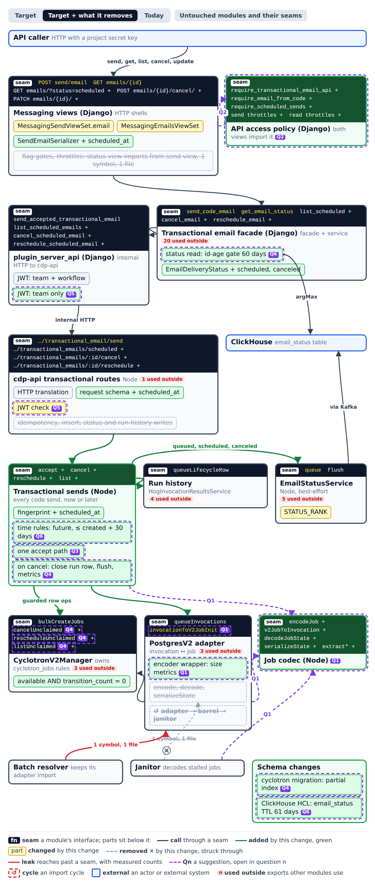
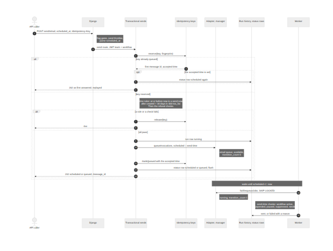
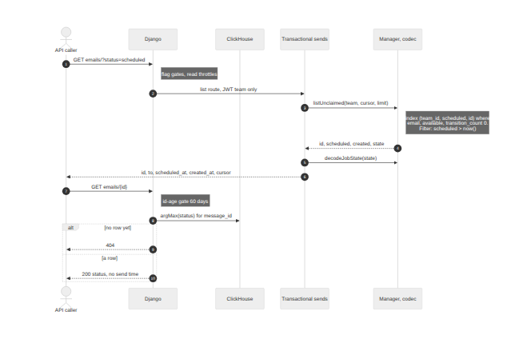
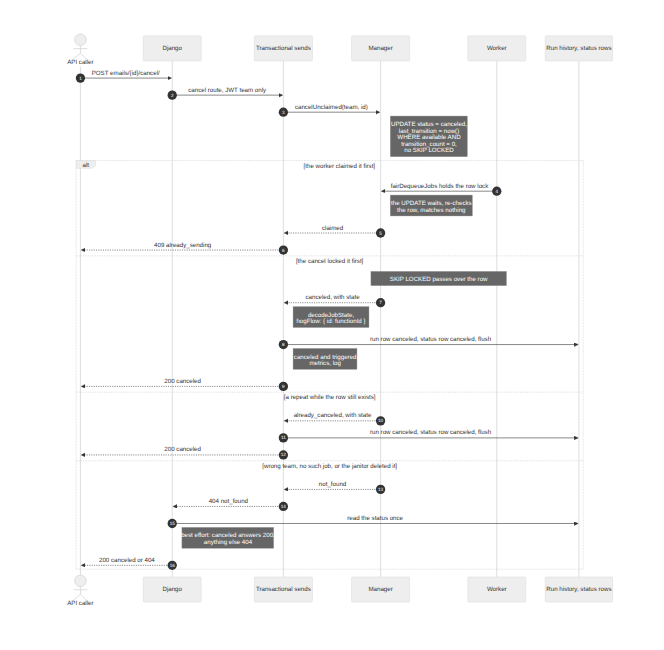

# Scheduled email sends

**Question.** Where does a scheduled transactional email live while it waits: in the queue job alone, or in a ledger beside it?
And which module owns each step from accept to send, cancel, reschedule and list?

**Answer.** The cyclotron job alone is the scheduled send.
It waits on the existing `email` queue with `scheduled` set to the requested time, and "never claimed" (`status = 'available' AND transition_count = 0`) is the scheduled state.
A new Node module, Transactional sends, owns every code and template send from accept until a worker claims it.
Django stays the only public face, and ClickHouse `email_status` stays the read model for one email's status.

This design builds on two open PRs: PostHog/posthog#127122 (the cdp-api send routes) and PostHog/posthog#127123 (the Django code send).
Code citations in the linked files point at master or at those PRs' heads.

## Modules and seams

[Module page with all views](scheduled-email-sends/round-2/modules.html) ([spec](scheduled-email-sends/round-2/spec.json)).
The page shows Target with what it removes.
Today shows the code as it is, and the untouched toggle shows the modules this change leaves alone.
The contracts round moved no module or seam.
It added one condition to the manager's existing upserts, and the access policy gained `require_email_status_read`.

| Module                                                    | Owns                                                                                                                                                                  |
| --------------------------------------------------------- | --------------------------------------------------------------------------------------------------------------------------------------------------------------------- |
| Django (`MessagingSendViewSet`, `MessagingEmailsViewSet`) | The public API, who may call it, parsing `scheduled_at`, the `require_scheduled_sends` flag, and the status read                                                      |
| API access policy (new Django module)                     | Every flag gate and throttle of the transactional email API, for both views                                                                                           |
| `plugin_server_api`                                       | The calls to cdp-api; cancel, reschedule and list use a token pinned to the team only                                                                                 |
| cdp-api routes                                            | HTTP translation and the token check                                                                                                                                  |
| Transactional sends (new Node module)                     | Idempotency, the time rules, the refusal checks, the run-history row, the queue insert, the `scheduled` and `canceled` status rows, and closing the run row on cancel |
| `CyclotronV2Manager`                                      | The "never claimed" rule as row operations: `cancelUnclaimed`, `rescheduleUnclaimed`, `listUnclaimed`                                                                 |
| Job codec (new Node module)                               | Encoding an invocation into a job row and decoding a row back, with type-only cyclotron imports                                                                       |
| `EmailStatusService`                                      | Status rows and their ranks                                                                                                                                           |

Untouched: the email worker and its consumer, HogFlowSchedule, the batch resolver, rerun (apart from the upsert condition), and the workflow worker.
The janitor keeps its cleanup behavior; only its decoder import moves to the job codec.

## Call paths

**Accept a send** ([source](scheduled-email-sends/final/write.mmd)):

**List waiting sends and read one status** ([source](scheduled-email-sends/final/read.mmd)):

**Cancel, racing a worker** ([source](scheduled-email-sends/final/failure.mmd)):

## Contracts

The interfaces are code: [Django](scheduled-email-sends/round-4/contracts.pyi) and [Node](scheduled-email-sends/round-4/contracts.ts).

### Invariants

- A job is in the scheduled state while it is on `email` with `status = 'available' AND transition_count = 0`.
  The first claim ends that state, and cancel and reschedule then answer `409 already_sending`.
- Cancel, reschedule and list each guard on that state, scoped by `team_id`, without `SKIP LOCKED`.
  An update that meets a claim's row lock waits, checks its guard again, and matches nothing.
- Reschedule also requires `cancel_requested_at IS NULL`, so a cancel from the existing run-cancel route wins over a reschedule, which answers `409 canceled`.
- `scheduled_at` must be at most 30 days after the message was created.
  The creation time comes from the message id, so a reschedule cannot extend the bound.
  A time at or before now is a send now at accept, and moves a waiting send to now at reschedule, even past the cap.
- The status stays `scheduled` from accept until the outcome. A reschedule writes a new `scheduled` row, and a cancel writes `canceled`.
- `STATUS_RANK` adds `scheduled` at 0 and `canceled` at 1. Ranks already written never change.
- The stored idempotency key records the accepted time. A replay answers from the stored key, never from the clock at replay time.
  The fingerprint stays unchanged when `scheduled_at` is absent, and appends it as a UTC ISO 8601 string when present.
- The status read accepts message ids up to 60 days old, and the `email_status` TTL is 61 days on `created_at`.
  Every email stays readable at least 30 days after its requested time, less any delay before the send.
- A `template_id` send takes its content and sender from the template at send time.
  A code send keeps the sender integration and the `from` fields it was accepted with. A `from` address or name the request left out comes from the integration at send time.
  Both forms verify the sender again at send time.

### Error modes

| Case                                                                                         | Answer                                                                                                              |
| -------------------------------------------------------------------------------------------- | ------------------------------------------------------------------------------------------------------------------- |
| `scheduled_at` without an offset, or the flag is off                                         | `400` on `scheduled_at` (Django)                                                                                    |
| `scheduled_at` more than 30 days after the message was created                               | `400 invalid_scheduled_at`, reason `too_far`                                                                        |
| Same idempotency key, other body or other `scheduled_at`                                     | `422 idempotency_key_reused`                                                                                        |
| Cancel or reschedule after a worker claimed the job                                          | `409 already_sending`                                                                                               |
| Reschedule of a canceled send, or one the run-cancel route marked with `cancel_requested_at` | `409 canceled`                                                                                                      |
| Cancel or reschedule of an unknown id or another team's                                      | `404`                                                                                                               |
| A repeated cancel after the janitor deleted the row                                          | `200` when the latest status is `canceled`, else `404`; best effort, because status rows have no delivery guarantee |
| Postgres or Valkey unavailable                                                               | `503`                                                                                                               |

### Duplicate-send windows

Two windows let one request send twice. Both exist for send-now today, and this design leaves them open.

- **A crash after the insert, before the queued key is stored.** The pending key expires 60 seconds after the reservation. A retry within that time gets `409 idempotency_key_in_flight`. A later retry is a new request and inserts a second job.
- **A retry after the stored key expires.** The key lives 24 hours. A send scheduled further out can still be waiting when its key expires, so a retry after that inserts a second waiting send.

### Performance

- Cancel and reschedule are a primary-key update, plus one primary-key read on a miss.
- The list is one range scan of at most 100 rows on a new partial index, `(team_id, scheduled, id) WHERE queue_name = 'email' AND status = 'available' AND transition_count = 0`. Send-now emails enter that index too, until a worker claims them.
- Each waiting send sits in the email worker's claim index and sorts ahead of the sends its team accepts later.
  On a local Postgres 14, the claim's selection step grew by about 20 ns per waiting send it stepped over: 2 ms at 100,000 waiting sends, 20 ms at 1,000,000.
  A gauge of waiting scheduled sends alerts at 100,000.

### Rollout

- `scheduled_at` ships behind `require_scheduled_sends`, separate from `workflows-email-from-code`, so scheduled sends can be turned off and drained without stopping every code send.
- The flag turns on only after every email worker and every cdp-api instance runs this change.
  An older cdp-api drops `scheduled_at` and sends at once.
  A cdp-api rollback past this change needs the flag off and no waiting sends.

## Decisions

- [ADR 0001: The queue job is the scheduled send](scheduled-email-sends/adr/0001-the-job-is-the-scheduled-send.md)
- [ADR 0002: Scheduled sends wait on the email queue](scheduled-email-sends/adr/0002-wait-on-the-email-queue.md)
- [ADR 0003: The scheduled list reads cyclotron](scheduled-email-sends/adr/0003-the-scheduled-list-reads-cyclotron.md)
- [ADR 0004: The schedule cap counts from creation](scheduled-email-sends/adr/0004-the-cap-counts-from-creation.md)
- [ADR 0005: Status ranks for scheduled and canceled](scheduled-email-sends/adr/0005-status-ranks.md)
- [ADR 0006: What a cancel guarantees](scheduled-email-sends/adr/0006-what-a-cancel-guarantees.md)

These locked seams miss the ADR bar, because each is easy to reverse or follows the obvious path:

- Transactional sends owns accept for send-now and scheduled sends alike: a module boundary that a refactor can move.
- The job codec and the API access policy module: internal moves with no lock-in.
- A team-only token for cancel, reschedule and list: every manager operation already filters by `team_id`.
- A time at or before now is a send now: the obvious reading, and what callers expect.
- A `template_id` send takes its sender from the template at send time: the same rule as its content.
- The separate `require_scheduled_sends` flag: a flag is cheap to remove.
- Four fields in a list row: a field set can grow without breaking callers.

## Follow-ups

Agreed in the rounds, with the strength recorded there:

| Follow-up                                                                                                       | Strength               |
| --------------------------------------------------------------------------------------------------------------- | ---------------------- |
| Move waiting sends out of the claim index, for example onto their own queue, once the waiting-sends alert fires | Strong, when triggered |
| Have the existing run-cancel route write `canceled` instead of `failed` with reason `canceled`                  | Worth exploring        |

Found by the deepening survey and not asked about in the rounds; each strength is an editorial estimate:

| Follow-up                                                                                                                                      | Strength        |
| ---------------------------------------------------------------------------------------------------------------------------------------------- | --------------- |
| The batch resolver imports the adapter for encoding; move it to the job codec                                                                  | Strong          |
| Put the template and workflow save behind one service call instead of ordering it in the view                                                  | Strong          |
| One transactional-message module that owns accepted content, scheduling, claim eligibility and delivery identity, with workflows as an adapter | Worth exploring |

### Rejected alternatives

Michael chose against these in round 4. They stay here so no one proposes them again without new facts.

- **A durable cancel record, checked in the same statement that inserts a rerun's job** (Q7 B). It closes the rerun race, at the cost of a new store that lives as long as reruns can reach a run. See ADR 0006.
- **Keep a job canceled before any claim past the janitor, so a repeated cancel always answers `200`** (Q3 B). It changes the janitor, which stays untouched. See ADR 0006.
