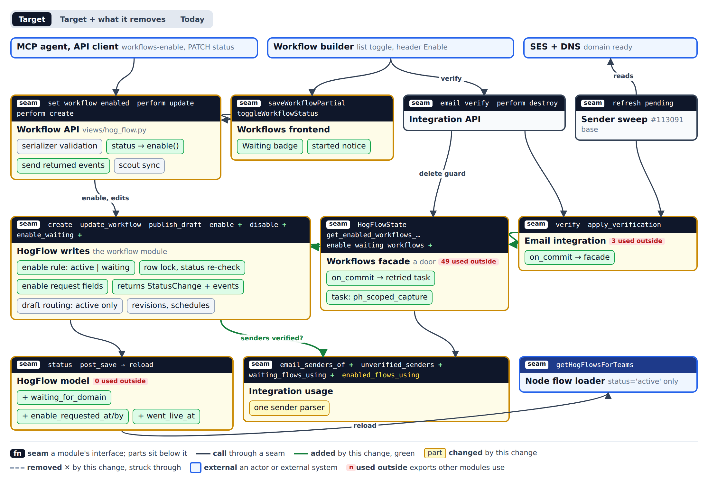
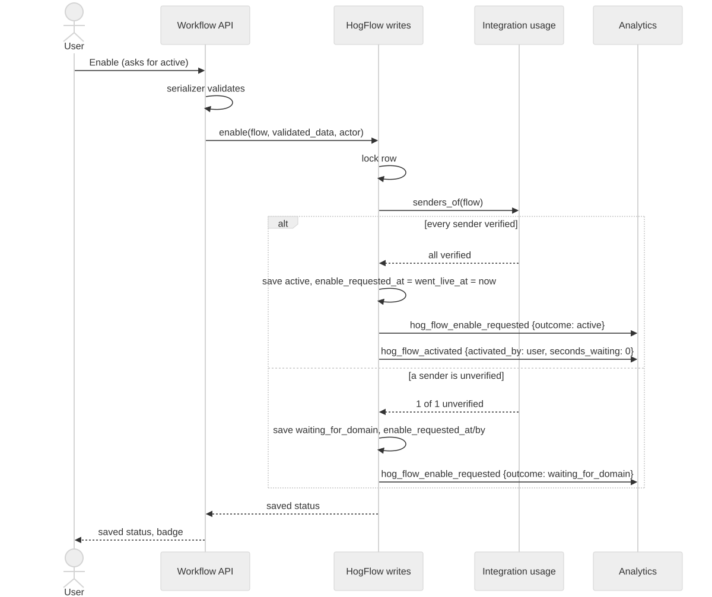
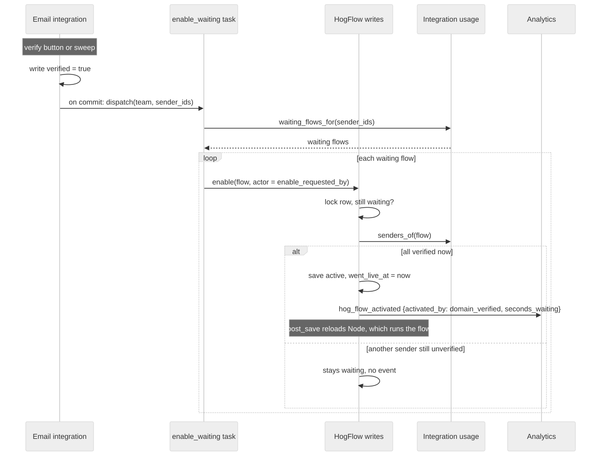
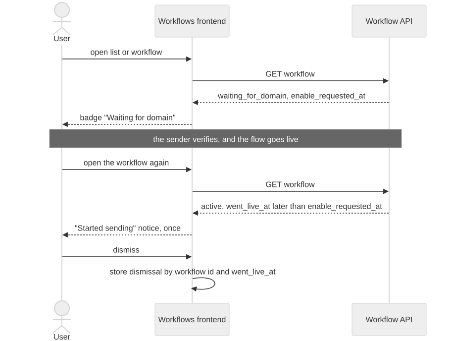
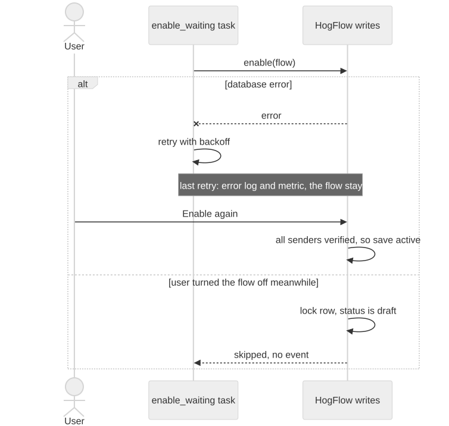

# Send once verified

## The question

A person can enable a workflow whose email sender is not verified yet.
Today the workflow goes `active`, and every email step then fails at send time in Node with "The selected email integration domain is not verified".
How should a workflow wait for its sender's domain, go live by itself when the domain verifies, and show that state to the person who enabled it?

The design adds one status, `waiting_for_domain`, and one enable rule in the workflow write module.
Every enable path calls that rule.
When a sender verifies, the same rule runs again for each waiting workflow that uses it.

It is gated by the `workflows-email-domain-wizard` flag and stacks on [#113091](https://github.com/PostHog/posthog/pull/113091), whose `_mark_matching_senders_verified` is the one function that writes `verified = true` for the verify button and the background sweep.

## Modules and seams

[](send-once-verified/modules.html)

The [module page](send-once-verified/modules.html) switches between three views: the target, the target with what it removes struck through, and today.
Its spec is [`modules.json`](send-once-verified/modules.json).

- **HogFlow writes** (`products/workflows/backend/services/hog_flow_writes.py`) is the one workflow module. It already owns create, update, publish draft, discard draft and destroy. `enable`, `disable` and `enable_waiting` join it. No separate lifecycle module exists.
- **Workflow API** (`presentation/views/hog_flow.py`) validates with `HogFlowSerializer`, calls `enable` or `disable`, and sends the events those functions return. The scout sync stays in the view.
- **Workflows facade** is a door with no logic. `enable_waiting_workflows` schedules the retried task after commit. `get_enabled_workflows_using_integration` replaces `get_active_workflows_using_integration` for the delete guard.
- **Integration usage** answers which email senders a workflow uses, which of them are unverified, which waiting workflows use a sender, and which enabled workflows use an integration. CDP validation keeps its own sender parser, so CDP does not depend on workflows.
- **Email integration** calls `enable_waiting_workflows` inside the transaction that writes `verified = true`.
- **HogFlow model** gains the status value and three fields. Node loads only `active` workflows, so it never runs a waiting one. Only its zod status type gains the value.
- **Workflows frontend** shows a "Waiting for domain" badge in the list and the header, and a one-time "Started sending" notice after the workflow goes live.

Out of scope: the send path, Node's flow loading, the sweep's scheduling and the domain wizard stack.
The wizard stack's `_mark_domain_verified` gets the same one-line call to `enable_waiting_workflows` when it rebases.

## Call paths

### Enable



### The sender verifies



### The status a person sees



### Going live fails or races



The Mermaid sources sit beside the SVGs in [`send-once-verified/`](send-once-verified/).

## Contracts

```python
# products/workflows/backend/facade/enums.py
class HogFlowState(LabeledStrEnum):
    DRAFT = "draft"
    ACTIVE = "active"
    WAITING_FOR_DOMAIN = "waiting_for_domain"
    ARCHIVED = "archived"


# products/workflows/backend/models/hog_flow/hog_flow.py, on HogFlow
enable_requested_at = models.DateTimeField(null=True, blank=True)
enable_requested_by = models.ForeignKey(
    "posthog.User", on_delete=models.SET_NULL, null=True, blank=True, related_name="+"
)
went_live_at = models.DateTimeField(null=True, blank=True)


# products/workflows/backend/facade/contracts.py
WorkflowEventName = Literal["hog_flow_enable_requested", "hog_flow_activated", "hog_flow_waiting_cancelled"]


@frozen
class WorkflowEvent:
    name: WorkflowEventName
    workflow_id: UUID
    user_id: int | None
    properties: Mapping[str, object]


@frozen
class StatusChange:
    workflow_id: UUID
    previous: HogFlowState
    current: HogFlowState
    events: tuple[WorkflowEvent, ...]


# products/workflows/backend/services/hog_flow_writes.py
def enable(*, team_id: int, hog_flow_id: UUID, user_id: int, validated_data: Mapping[str, object]) -> StatusChange: ...
def disable(*, team_id: int, hog_flow_id: UUID) -> StatusChange: ...
def enable_waiting(*, team_id: int, sender_ids: frozenset[int]) -> tuple[StatusChange, ...]: ...


# products/workflows/backend/services/integration_usage.py
def email_senders_of(flow: HogFlow) -> frozenset[int]: ...
def unverified_senders(*, team_id: int, sender_ids: frozenset[int]) -> frozenset[int]: ...
def waiting_flows_using(*, team_id: int, sender_ids: frozenset[int]) -> list[UUID]: ...
def enabled_flows_using(*, team_id: int, integration_id: int) -> list[HogFlow]: ...


# products/workflows/backend/facade/api.py
def enable_waiting_workflows(*, team_id: int, sender_ids: Iterable[int]) -> None:
    ids = sorted(set(sender_ids))
    transaction.on_commit(lambda: enable_waiting_workflows_task.delay(team_id=team_id, sender_ids=ids))


def get_enabled_workflows_using_integration(*, team_id: int, integration_id: int) -> list[WorkflowSummary]: ...


# products/workflows/backend/tasks/hog_flows.py
@shared_task(
    ignore_result=True,
    queue=CeleryQueue.DEFAULT.value,
    max_retries=5,
    autoretry_for=(DatabaseError,),
    retry_backoff=True,
)
def enable_waiting_workflows_task(team_id: int, sender_ids: list[int]) -> None: ...
```

On the API, `HogFlowSerializer` returns `enable_requested_at` and `went_live_at` as read-only fields, and `status` gains `waiting_for_domain`.
`enable_requested_by` stays off the API.
`hogli build:openapi` regenerates the frontend types.
The handwritten zod enums in `products/workflows/frontend/Workflows/hogflows/types.ts` and `nodejs/src/cdp/schema/hogflow.ts` gain the value.
`HogFlowAdmin` lists `enable_requested_by` in `raw_id_fields`.

### Enable paths

Every path that turns a workflow on calls `enable`: the header Enable button, the list toggle, the MCP `workflows-enable` tool (`set_workflow_enabled`), and an API create or PATCH with `status: active`.
The client keeps asking for `active`, and the response carries the status the server saved.
`set_workflow_enabled` returns that saved status.
Transactional email workflows stay out, because they already refuse an unverified sender.

A waiting workflow runs nothing, so edits to it save in place, and draft routing stays for `active` workflows only.
The serializer validates each edit to a waiting workflow as strictly as an activation, so `enable_waiting` can take it live without validating again.
After such an edit, `update_workflow` calls `enable` again, so switching a waiting workflow to a verified sender takes it live.

### Events

`enable`, `disable` and `enable_waiting` decide the events and return them in `StatusChange.events`.
They never send them.
The view sends them after commit with `report_user_action(..., analytics_props=get_request_analytics_properties(request))`.
The task sends them with `ph_scoped_capture`, because events from the global client are lost in a Celery task.

| Event                        | When                                     | Properties beyond `workflow_id` and the org and project groups                                                |
| ---------------------------- | ---------------------------------------- | ------------------------------------------------------------------------------------------------------------- |
| `hog_flow_enable_requested`  | every Enable a person makes              | `outcome`: `active` or `waiting_for_domain`, `unverified_sender_count`, the request's source properties       |
| `hog_flow_activated`         | every switch to `active`                 | `activated_by`: `user` or `domain_verified`, `seconds_waiting` (0 for a direct enable), `enable_requested_at` |
| `hog_flow_waiting_cancelled` | disable, archive or delete while waiting | `seconds_waiting`                                                                                             |

Every event is credited to `enable_requested_by`.
The task's events carry no `source`, because `EventSource` has no value for background work.
Analysis links them to the web, MCP or API Enable through `workflow_id` and the person.
`hog_flow_activated` now also fires for MCP enables and for workflows that go live after verification, so existing insights on it count more activations than before.

### Invariants

- Only `hog_flow_writes` writes `status`, `enable_requested_at`, `enable_requested_by` and `went_live_at`.
- `enable` sets `enable_requested_at` and `enable_requested_by` on every call a person makes, and sets `went_live_at` only when it saves `active`. A direct enable sets all three to the same moment. A disable leaves them in place, and the next Enable overwrites them. A waiting workflow therefore has `went_live_at` empty or older than `enable_requested_at`.
- `enable` takes `select_for_update` on the row and acts only when the locked status is the one the caller expects.
- `enable` saves `active` without the sender check when `workflows-email-domain-wizard` is off for the team. `enable_waiting`, the badge and the delete guard ignore the flag, so turning it off never leaves a workflow waiting.
- `enable_waiting` acts only on rows whose locked status is still `waiting_for_domain`, and saves `active` only when the workflow has no unverified sender left. Running it twice gives the same rows and no new events, so a task retry is safe.
- The delete guard refuses to delete a sender that an active or a waiting workflow uses.
- The frontend shows "Started sending" once when a workflow is `active` and `went_live_at` is later than `enable_requested_at`. It stores the dismissal in the browser, keyed by workflow id and `went_live_at`.

### Error modes

| Call             | Fails how                                | What happens                                                                                                                                               |
| ---------------- | ---------------------------------------- | ---------------------------------------------------------------------------------------------------------------------------------------------------------- |
| `enable`         | the workflow does not exist for the team | `HogFlow.DoesNotExist`, a 404 in the view                                                                                                                  |
| `enable`         | the workflow is archived                 | returns a `StatusChange` with no change and no events                                                                                                      |
| `enable_waiting` | database error                           | raises. The task retries with backoff up to 5 times, then logs an error and counts a metric. The workflow stays waiting until a person clicks Enable again |
| `enable_waiting` | the person turned the workflow off first | the locked status is `draft`, so the row is skipped with no event                                                                                          |
| sending an event | the analytics client fails               | logged and swallowed. A status change never rolls back for analytics                                                                                       |

### Performance

- `enable` takes one row lock, parses the workflow's actions once, and runs one `Integration` query for its senders.
- `waiting_flows_using` reads only the team's `waiting_for_domain` rows through the existing `(status, team)` index. That set stays small, because a workflow waits only until its domain verifies.
- The task adds one Celery dispatch per verification write, and a delay of a few seconds before a waiting workflow goes live.

## Decisions

The ADRs in [`products/workflows/adr/`](../../products/workflows/adr/) record the seams that are hard to reverse:

- [0001](../../products/workflows/adr/0001-waiting-for-domain-is-a-status.md): waiting for a domain is a status value, not a split between intent and readiness.
- [0002](../../products/workflows/adr/0002-verification-pushes-waiting-workflows-live.md): the verified write pushes waiting workflows live through a retried task.
- [0003](../../products/workflows/adr/0003-the-enable-request-is-stored-on-the-workflow.md): the enable request is stored on the workflow.

These locked seams miss the ADR bar, because each is easy to reverse or is the obvious choice:

- `enable`, `disable` and `enable_waiting` live in `hog_flow_writes`, not in a new module.
- The writes functions return events and the entrypoint sends them.
- The facade schedules the task after commit itself.
- The flag gates only the sender check in `enable`.
- Waiting workflows edit in place, validated as strictly as an activation.
- The delete guard counts waiting workflows.
- The API exposes `enable_requested_at` and `went_live_at`, and not `enable_requested_by`.
- Background events carry no `source`.
- The "Started sending" notice is dismissed in the browser.

## Follow-ups

- **Workflows owns email sender verification** (Strong). Core `email.py` calls the workflows facade to verify a sender and set the default sender, and the sweep calls back into core. A workflows-owned sender module removes that cycle. It waits until the #113091 and domain wizard stacks have landed.
- **One Workflows service for reads, writes and status** (bold). Merge `hog_flow_reads.py` and `hog_flow_writes.py`, and move the remaining status side effects out of the view module, as a stacked base PR.
- **Move the scout sync out of the view** (Moderate). It needs the request today, so it stays in `perform_update` and does not run for MCP enables or for workflows that go live after verification.
- **Reconcile stuck waiting workflows** (Weak). A periodic job that takes live each waiting workflow whose senders are all verified. Build it only if the metric for the task's last failed retry ever fires.
- **One sender parser for the broadcast launch check** (Moderate, not asked in the rounds). `getSenderLaunchError` in `broadcastWizardLogic.ts` parses senders a third way. The frontend could read the unverified senders from the API instead.
