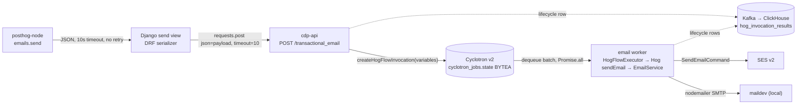

# Scope: attachments on the transactional email send API

Spike branch `spike/email-attachments`, based on `upstream/master` at `3c352f32116`.
Question: how much work is it to accept Resend-style `attachments` on the transactional send API and deliver them through SES, so an app that sends an `invite.ics` through Resend today can switch.

## Answer in short

- **Riskiest finding:** attachment bytes must not travel in `variables` or anywhere else in the hog flow state.
  - Every lifecycle row serializes the whole flow state into Kafka and ClickHouse `hog_invocation_results`.
  - The email worker runs a whole dequeued batch (up to `CONSUMER_BATCH_SIZE`, default 500) at the same time.
  - So inline bytes are only safe under a small cap, with explicit stripping.
  - 40MB needs object storage by reference, plus concurrency bounded by bytes.
- **SES is not the blocker.**
  - The installed `@aws-sdk/client-sesv2` 3.985.0 supports `Simple.Attachments`.
  - The spike proves the `Raw` path end to end: one MIME composer that works for both SES and maildev, keeps our headers, and carries the `.ics` invite. It also shows the wire cost.
- **Smallest first slice** (4 PRs, about M+M+M+S): inline attachments capped at 512KB total, sent as `Raw` MIME. That is enough for the calendar-invite driver.
- **Large attachments** (up to Resend's 40MB) come after, via object storage. That needs infra outside this repo (a bucket, and IAM for the email worker pods).

## The path an attachment must cross



### 1. Request size limits

| Layer                      | Limit today                                                                                         | Evidence                                                                                                                                                                                                          |
| -------------------------- | --------------------------------------------------------------------------------------------------- | ----------------------------------------------------------------------------------------------------------------------------------------------------------------------------------------------------------------- |
| posthog-node               | One attempt, 10s default timeout, JSON body                                                         | `packages/node/src/client.ts:3009-3026` (`retryCount: 0`), `packages/core/src/posthog-core-stateless.ts:451` on `origin/feat/node-emails-send` in posthog-js                                                      |
| Production ingress / proxy | Not in this repo                                                                                    | Open question 4                                                                                                                                                                                                   |
| Django (granian)           | `DATA_UPLOAD_MAX_MEMORY_SIZE = 20MB`, global                                                        | `posthog/settings/web.py:262`. Django enforces it on `request.body` access. DRF's JSON parser reads the stream, so whether it applies here depends on whether middleware touches `request.body` first. Unchecked. |
| Django to cdp-api          | `requests.post(json=payload, timeout=10)`                                                           | `posthog/plugins/plugin_server_api.py:275-283`                                                                                                                                                                    |
| cdp-api                    | `express.json({ limit: '20mb' })`, 413 handler                                                      | `nodejs/src/common/api/router.ts:73-80`, `:89-90`. The 512KB `publicBodySizeLimit` covers only public webhook routes (`nodejs/src/cdp/cdp-api.ts:371-377`), not this route.                                       |
| SES v2                     | 40MB per message after base64, not adjustable; over 10MB is bandwidth-throttled to as low as 40MB/s | [SES quotas](https://docs.aws.amazon.com/ses/latest/dg/quotas.html)                                                                                                                                               |
| Resend (parity target)     | 40MB per email after base64 of the attachments; no count cap; no attachments on batch               | [send-email](https://resend.com/docs/api-reference/emails/send-email), [attachments](https://resend.com/docs/dashboard/emails/attachments)                                                                        |

Base64 costs twice (measured in the spike, test 2):

- In the MIME message, attachments cost about 4/3 of their bytes.
- SES then receives that MIME base64-encoded again inside JSON, which comes to about 16/9 on the wire.
- So "40MB after base64" allows about 30MB of decoded attachment bytes.
- The SDK to Django leg alone carries 4/3 of the decoded size, so it hits Django's and cdp-api's 20MB limits at about 15MB decoded.

### 2. Validation today

- Django: `SendTransactionalEmailSerializer` has `to`, `identifiers` and `message_data` (`products/messaging/backend/presentation/views/message_templates.py:289-301`). The send view is at `:614-642`.
- The service puts `message_data` into the payload as `variables` (`products/messaging/backend/services/transactional_email.py:204-209`).
- cdp-api: the zod schema `TransactionalEmailRequestSchema` has `to`, `distinct_id` and `variables` (`nodejs/src/cdp/services/hogflows/transactional-email.ts:5-11`).
  Unknown keys are stripped, so an `attachments` field sent today is silently dropped.
- Worker: `CyclotronInvocationQueueParametersEmailSchema` has no attachments (`nodejs/src/cdp/schema/cyclotron.ts:151-173`).
- Note: the Resend-like endpoint that the SDK draft targets (`/api/projects/@current/messaging/send/email/`, `emails.ts:5`) is not on `upstream/master`. Master has only the per-template `send` action.

### 3. Where the bytes would live while queued

- cdp-api builds the run from `variables` (`nodejs/src/cdp/cdp-api.ts:1178-1188`) with `createHogFlowInvocation`.
  That function merges `variables` into `state.variables` (`nodejs/src/cdp/services/hogflows/hogflow-executor.service.ts:66-92`).
  It then queues the run on `email` at fast priority (`cdp-api.ts:1190-1193`).
- Cyclotron v2 row: one `state BYTEA` column (`rust/cyclotron-node-migrations/20260303000001_initial_schema.sql:24`).
  It holds the plain `JSON.stringify` of state, queue parameters and metadata (`nodejs/src/cdp/services/job-queue/job-queue-postgres-v2.ts:290-296`).
  It is not compressed: the "compressed" histogram observes the same length (`:301-302`).
  - BYTEA accepts up to 1GB, so a 40MB row is legal.
  - The cost shows up elsewhere: each reschedule (SES throttle, pacing, frequency cap) rewrites the whole blob (`nodejs/src/cdp/services/cyclotron-v2/types.ts:73`).
  - The README says the state blob mirrors the Kafka serialization (`nodejs/src/cdp/services/cyclotron-v2/README.md`, "Schema").
  - The sanitizer exists to strip "large and easily reloaded" person and group data before persisting (`nodejs/src/cdp/services/job-queue/shared.ts:55-90`).
- Hog flows and email use the Postgres backend, not Kafka (`nodejs/src/server.ts:176-182`, `:347-365`).
- **Worker memory.** The email worker dequeues up to `CONSUMER_BATCH_SIZE` rows (default 500, `nodejs/src/common/config.ts:411`, passed at `server.ts:359`).
  It executes the whole batch with `Promise.all` (`nodejs/src/cdp/consumers/cdp-cyclotron-worker-hogflow.consumer.ts:49`).
  - Peak per send is about 4x the decoded size: state JSON, decoded bytes, MIME, then the SDK's base64 JSON.
  - At a 512KB cap the worst case is about 1.5GB for a full batch.
  - At 30MB it is far past any pod.
- **ClickHouse and Kafka.** Each lifecycle row (running, then completed or failed) serializes the hog flow's whole `state` into `invocation_globals` (`nodejs/src/cdp/services/monitoring/hog-invocation-results.service.ts:233-243`).
  - That field is gzip+base64'd into one Kafka message (`:466-480`). Base64 attachments barely compress.
  - Producer `message.max.bytes` comes from env (`nodejs/src/cdp/outputs/producers.ts:196`). librdkafka's default is about 1MB.
  - Consumers fetch at most 10MB (`nodejs/src/common/kafka/consumer/consumer-v1.ts:190`).
  - Cdp-api writes the first row before the job even runs (`cdp-api.ts:1195`).
- Hog flow step outputs are capped at 5KB of variables (`hogflow-executor.service.ts:987-1000`). Entry `variables` are not capped, which is one more reason not to put bytes there.

**Inline vs object storage**

|                          | Inline in invocation state                                            | Object storage by reference                                                                                                                                                                 |
| ------------------------ | --------------------------------------------------------------------- | ------------------------------------------------------------------------------------------------------------------------------------------------------------------------------------------- |
| Fits                     | Small cap only (proposal: 512KB total decoded)                        | Up to SES's 40MB                                                                                                                                                                            |
| Cyclotron row            | Bytes, rewritten on every reschedule                                  | Refs of about 200B each                                                                                                                                                                     |
| `hog_invocation_results` | Must strip the bytes. A rerun then can't resend them and must refuse. | Refs survive, so a rerun works while the object exists (TTL)                                                                                                                                |
| Worker memory            | Bounded by the cap × batch                                            | Needs a byte-bounded semaphore: fetch, compose and send one large email at a time                                                                                                           |
| New infra                | None                                                                  | Bucket with lifecycle TTL, Django write, email worker read IAM, new S3 config in CDP                                                                                                        |
| Precedent                | —                                                                     | AI blob offload stores large payloads by pointer (`nodejs/src/ingestion/pipelines/ai/blob-offload/blob-store.ts`). Django already writes objects (`posthog/storage/object_storage.py:540`). |

### 4. SES: `Simple` or `Raw`

- Installed SDK: `@aws-sdk/client-sesv2` **3.985.0** (`nodejs/package.json:65` pins `^3.980.0`).
- `Message` (the `Simple` content) has `Attachments?: Attachment[]`.
  `Attachment` has `RawContent: Uint8Array`, `FileName`, `ContentType?`, `ContentDisposition?` (`ATTACHMENT` or `INLINE`), `ContentId?`, `ContentTransferEncoding?` and `ContentDescription?`.
  See `nodejs/node_modules/@aws-sdk/client-sesv2/dist-types/models/models_0.d.ts:111-158` and `:1698-1722`.
- `EmailContent.Raw: { Data: Uint8Array }` takes a full MIME message (`models_0.d.ts:1657-1692`, `:1731-1778`).
- AWS docs confirm that `Simple` and `Template` attachments let SES build the MIME, and that `Raw` keeps working ([SES attachments](https://docs.aws.amazon.com/ses/latest/dg/attachments.html)).
- Today the worker sends `Simple` and puts our headers on `Simple.Headers`: tracking code, `Auto-Submitted`, `List-Unsubscribe` (`nodejs/src/cdp/services/messaging/email.service.ts:1118-1169`).

So `Simple.Attachments` is the smaller diff. The recommendation is still `Raw` for sends that carry attachments, because:

- With `Simple`, SES builds the MIME. Nothing in the docs says SES keeps a `ContentType` parameter such as `method=REQUEST`, and that can't be checked without live SES. With `Raw` we own every byte, and the spike checks it.
- maildev needs the same message. The maildev path already uses nodemailer (`email.service.ts:1035-1075`). With one composer for both, local dev shows exactly what SES gets (spike test 3).
- Only `Raw` can place a `text/calendar` part inside `multipart/alternative`, which Outlook's native meeting UI wants. nodemailer's `icalEvent` does exactly that (`nodejs/node_modules/nodemailer/lib/mail-composer/index.js:162-183`, `:250-276`).

`FromEmailAddress`, `Destination` (which carries Bcc, since nodemailer drops the Bcc header), `ConfigurationSetName`, `EmailTags` and `TenantName` stay top-level fields with `Raw`. The spike asserts the first five survive the real SDK serializer.

**The `.ics` driver.**

- Resend has no calendar feature. The driver app sends `invite.ics` as a plain attachment with `content_type: text/calendar; method=REQUEST`, and that already renders as an invite through Resend.
- Parity is therefore "attachment with its content type intact". The spike proves that part comes out as `Content-Type: text/calendar; method=REQUEST; charset=utf-8; name=invite.ics` with `Content-Disposition: attachment`.
- Promoting a `text/calendar` attachment into the alternative part, like `icalEvent`, is a later option.
  nodemailer itself warns that a calendar alternative plus attachments shows a blank screen in some clients (`mail-composer/index.js:249`). So only do it after a client proof.

### 5. Tracking and logging

What must never carry attachment bytes:

| Sink                                                        | Today                                                                                                      | Needed                                                                                                                                           |
| ----------------------------------------------------------- | ---------------------------------------------------------------------------------------------------------- | ------------------------------------------------------------------------------------------------------------------------------------------------ |
| `hog_invocation_results` (Kafka → ClickHouse, rerun source) | Whole flow state (`hog-invocation-results.service.ts:238-242`)                                             | Strip content and keep `{filename, content_type, size, sha256}`. Refuse a rerun that would send without attachments.                             |
| Cyclotron state                                             | Plain JSON                                                                                                 | OK under the inline cap. Refs only for large.                                                                                                    |
| Hog VM and `sendEmail`                                      | Mock path logs `JSON.stringify(args[0])` into run logs (`nodejs/src/cdp/async-functions/send-email.ts:24`) | Keep attachments out of Hog inputs. EmailService adds them after `sendEmail`, at the send choke point (`hog-executor-async.service.ts:168-189`). |
| Run logs                                                    | `Email sent to … from …` (`email.service.ts:659`)                                                          | Add a count and total size only                                                                                                                  |
| Sent-email assets ("View email")                            | `html` only (`message-assets.service.ts:129-164`)                                                          | Nothing; optionally list filenames                                                                                                               |
| Django usage event                                          | Outcome only (`message_templates.py:703-722`)                                                              | Add count and size                                                                                                                               |
| Validation errors                                           | —                                                                                                          | Never echo `content` in a 400                                                                                                                    |

Tracking with `Raw`:

- PostHog rewrites the HTML before it composes the message (`email-tracking.service.ts:146-190`, SES mode adds `ses:no-track`). The composer takes the final HTML, so nothing changes there.
- The SES tracked configuration set (`email.service.ts:949-968`) rewrites links in raw messages too. The docs say the open-tracker placeholder works in "formatted, raw, and templated" email ([SES metrics FAQ](https://docs.aws.amazon.com/ses/latest/dg/faqs-metrics.html)). This is owed a live proof.
- The spike shows nodemailer writes the tracking header as `X-Posthog-Tracking-Code`. The SES webhook matches header names case-insensitively (`nodejs/src/cdp/services/messaging/helpers/ses.ts:705-707`), so this is safe. A future case-sensitive reader would break.
- nodemailer encodes the 5,000-character HTML line as quoted-printable. Every line stays at 998 characters or less, which SES requires (spike test 1).

### 6. SDK (posthog-node)

- The draft's `SendEmailOptions` has `template`, `to`, `data` and `distinctId` (`packages/node/src/emails.ts:33-42`). `sendBody` maps them to snake_case (`:384-391`).
- Proposal:

  ```ts
  export interface EmailAttachment {
    filename: string
    /** A Buffer or Uint8Array, or a Base64 string. */
    content: string | Uint8Array
    contentType?: string
    /** Reference it as `` to show the attachment inline. */
    contentId?: string
  }
  // SendEmailOptions.attachments?: EmailAttachment[]
  ```

- The SDK base64-encodes `Uint8Array` content (`Buffer` is one) and sends a string as given, which matches Resend.
- The wire shape is `{filename, content, content_type, content_id}`.
- The SDK checks the cap before sending and returns `attachments_too_large` without a network call.
- `path` (URL) is left out until the server can fetch safely. Resend users who pass `path` get a compile error, not a silent drop.

### 7. Abuse, limits and billing

- **Extension blocklist:**
  - SES rejects about 80 extensions (`.exe`, `.js`, `.bat`, …, [list](https://docs.aws.amazon.com/ses/latest/dg/attachments.html#mime-types)). Resend publishes almost the same list ([KB](https://resend.com/docs/knowledge-base/what-attachment-types-are-not-supported)).
  - Validate it in Django so the caller gets a 400, not an async failure in run logs.
  - `.ics` is allowed.
- **Content-type allowlist:** neither Resend nor SES uses one. Keep parity, and derive the type from the extension when it is absent (nodemailer's `detectMimeType`).
- **Count:** Resend has no cap, and SES allows 500 MIME parts ([quotas](https://docs.aws.amazon.com/ses/latest/dg/quotas.html)). Proposal: 10 per email.
- **`content_id`:** under 128 characters (Resend).
- **Filename:** no CR or LF, 255 characters at most.
- **Virus scanning:** neither Resend's docs nor SES's sending docs mention scanning outbound attachments. SES scanning (`ScanEnabled`) is for receiving only, so nothing in the path scans today. Open question 2.
- **Security, found in the spike:**
  - nodemailer resolves an attachment's `path` or `href` by reading a local file or fetching a URL (`mail-composer/index.js:127-148`).
  - Caller-controlled attachments must never reach it like that.
  - The composer sets `disableFileAccess` and `disableUrlAccess` (`nodejs/node_modules/nodemailer/lib/mime-node/index.js:985-999`) and accepts only `Buffer` content.
- **Billing:**
  - PostHog bills `workflow_emails_sent`, one per send (`nodejs/src/cdp/services/hogflows/actions/hog_function.ts:34`). Quota is checked per email at cdp-api (`hogflow-quota-limiting.ts:37-45`), and an attachment does not change that unit.
  - Resend bills per email too ([pricing](https://resend.com/pricing)).
  - SES charges $0.12 per GB of attachment data on top of the per-email price ([SES pricing](https://aws.amazon.com/ses/pricing/)).
    - A 512KB attachment adds about $0.00006, which is less than SES's own per-email price.
    - A 30MB one adds about $0.0036, roughly 36 times it.
  - Throttles count requests (600/min, `message_templates.py:334-352`), not bytes.

## Spike

What it proves: one composer produces a `Raw` MIME message that the real SES v2 SDK serializes and that maildev receives. The message keeps the calendar invite's content type, a binary attachment, our headers and Reply-To, and leaves out Bcc. It also measures the wire cost.

- `nodejs/src/cdp/services/messaging/helpers/raw-mime.ts`: `composeRawEmail(RawEmail): Promise<Buffer>` on nodemailer's `MailComposer`, with file and URL access disabled.
- `nodejs/src/cdp/services/messaging/helpers/raw-mime.test.ts`:
  1. Sends through a real `SESv2Client` with a capturing request handler, decodes `Content.Raw.Data`, and asserts the MIME tree, the headers, no Bcc, and lines of 998 characters or less.
  2. Measures the overhead: MIME is 1.33–1.4× the attachment bytes, and the SES request body is 1.77–1.9×.
  3. Sends to the local maildev over SMTP and reads back `invite.ics` (`text/calendar`) and `rules.pdf` (`application/pdf`).
- Run: `pnpm exec jest --config jest.config.js --testPathPatterns='messaging/helpers/raw-mime.test.ts' --testPathIgnorePatterns='/node_modules/'`, which needs maildev on `:1025`/`:1080`.
  The override is needed in a `.claude/worktrees/...` checkout, where the default `testPathIgnorePatterns` drops every test.
  Result: 3 passed.

MIME structure it produces:

```text
Content-Type: multipart/mixed
├── multipart/alternative
│   ├── text/plain; charset=utf-8
│   └── text/html; charset=utf-8          (quoted-printable when a line is long)
├── text/calendar; method=REQUEST; charset=utf-8; name=invite.ics   (attachment, base64)
└── application/pdf; name=rules.pdf                                  (attachment, base64)
```

Not proven, because there are no SES credentials here: how Gmail, Outlook and Apple Mail render the invite through SES, and whether SES open and click tracking fires on `Raw`.

## Recommended design

1. **API:** Resend's shape, `attachments: [{ filename, content (base64), content_type?, content_id? }]`. `path` comes later.
2. **Django** validates: count, total decoded size, base64, the extension blocklist, `content_id` and the filename.
   - It forwards attachments to cdp-api as a top-level `attachments` field, never in `message_data`.
3. **cdp-api** re-checks the caps in zod and puts attachments on a dedicated `state.attachments` of the hog flow invocation, not in `variables`.
4. **Worker:** the email step's send reads `state.attachments` at the EmailService choke point.
   - With attachments, it composes `Raw` MIME with `composeRawEmail` for both SES and maildev. Without, it keeps today's `Simple` path, which limits the blast radius.
5. **Results:** `hog_invocation_results` stores attachment metadata, never content. A rerun of an invocation that had attachments fails with a clear log until object storage lands.
6. **Large attachments:** Django writes decoded bytes to object storage under a team-scoped key with a lifecycle TTL longer than the longest retry window, and passes refs.
   - The worker fetches them under a byte-bounded semaphore. The cap rises to about 30MB decoded (40MB MIME).

## PR breakdown

**First slice, inline with a 512KB cap. It unblocks the `.ics` driver.**

| #   | PR                                                                       | Size | Contents                                                                                                                                                                                                                  |
| --- | ------------------------------------------------------------------------ | ---- | ------------------------------------------------------------------------------------------------------------------------------------------------------------------------------------------------------------------------- |
| 1   | `feat(workflows): send emails with attachments as raw mime`              | M    | `composeRawEmail` (this spike), `attachments` on the email send params, a `Raw` SES branch and the maildev branch, metadata in the run log. Tests: the spike's unit test, plus a maildev case in `email.service.test.ts`. |
| 2   | `feat(workflows): carry transactional email attachments through the run` | M    | `TransactionalEmailRequestSchema.attachments` with zod caps, `state.attachments` on the run, handoff to the email step, stripping in `hog_invocation_results`, a rerun guard.                                             |
| 3   | `feat(messaging): accept attachments on the transactional email api`     | M    | Serializer field and validation, forwarding, OpenAPI regen, docs, usage event props, behind the existing `workflows-transactional-email-api` flag. Lands on whichever send endpoint is live (open question 5).            |
| 4   | `feat(node): attachments on posthog.emails.send` (posthog-js)            | S    | `EmailAttachment` type, Buffer to base64, client-side cap check, `attachments_too_large`.                                                                                                                                 |
| —   | Live proof, no PR                                                        | S    | Send an `invite.ics` from a sandbox SES identity to Gmail, Outlook and Apple Mail. Check the RSVP UI, and the SES open and click events on `Raw`.                                                                         |

**Then: large attachments and the rest of parity**

| #   | PR                                                   | Size | Contents                                                                                                                                                                               |
| --- | ---------------------------------------------------- | ---- | -------------------------------------------------------------------------------------------------------------------------------------------------------------------------------------- |
| 5   | Object storage by reference                          | L    | Bucket and TTL, plus email worker IAM, in infra (other repo). Django write, CDP S3 read config, refs in state, rerun works while objects live.                                         |
| 6   | Raise the cap to 40MB                                | M    | Request path: Django body limit for this endpoint, ingress limit, byte-based throttle, SDK timeout guidance. Worker: byte-bounded send concurrency and SES >10MB bandwidth throttling. |
| 7   | `path` (URL) attachments                             | M    | Fetch through `posthog/egress/` with SSRF guards, size cap and timeout. Optional.                                                                                                      |
| 8   | Promote `text/calendar` into `multipart/alternative` | S    | Only if the live proof shows Outlook needs it.                                                                                                                                         |
| 9   | Attachment billing or scanning                       | S–M  | Only if decided (open questions 1 and 2).                                                                                                                                              |

The smallest useful slice is PRs 1–4, stacked 1→2→3, with 4 in posthog-js.

## Risks

- **Memory on the email worker.** A whole batch runs at once, so the inline cap times `CONSUMER_BATCH_SIZE` is the real bound. Check the production value of `CONSUMER_BATCH_SIZE` for the email pods before picking the cap.
- **Kafka message size** for `hog_invocation_results` if the strip in PR 2 misses a path, for example the DLQ replay consumer. That needs a test on the serializer itself.
- **`Raw` changes the SES path.** Keeping `Simple` for sends without attachments limits it to new traffic, but tracking on `Raw` is owed a live proof.
- **Header case.** nodemailer normalizes `X-PostHog-Tracking-Code` to `X-Posthog-Tracking-Code`, which is safe for today's webhook only.
- **Reputation.** Attachments are the classic malware and phishing vector, and they now leave from PostHog's SES account. The account is partitioned per team by `TenantName` (`email.service.ts:1152`).
- **Cross-version rollout.** A queued job with `state.attachments`, picked up by an old worker during a mixed-pod deploy, sends without attachments. PR 2 needs the worker side (PR 1) deployed first, or a version gate.

## Open questions for Michael

1. **Billing:** absorb SES's $0.12/GB at the 512KB cap and revisit for large attachments, or meter attachment GB from day one?
2. **Scanning:** ship without virus scanning (parity with Resend's documented behavior), or gate attachments to paid or verified-domain teams first?
3. **Cap:** is 512KB total decoded right for the first slice? It covers invites and small receipts. 1MB doubles the worst-case batch memory.
4. **Ingress:** what body limit does the production ingress put in front of Django? It is not in this repo, and it decides PR 6.
5. **Endpoint:** which endpoint gets attachments, the per-template `send` on master or the new `/messaging/send/email/` the SDK draft calls?
6. **SES proof:** is there a sandbox SES identity to run the live invite and tracking proof from?
7. **Rerun:** in the inline slice, is it acceptable that a rerun of an email with attachments is refused rather than resent without them?
